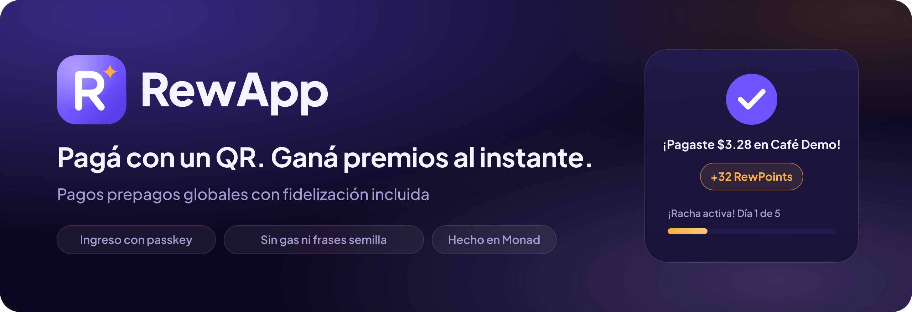
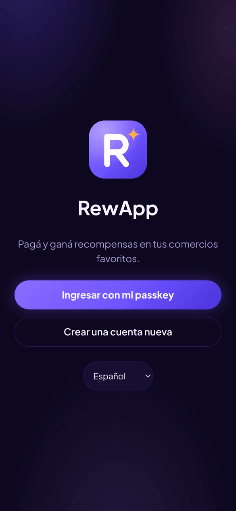
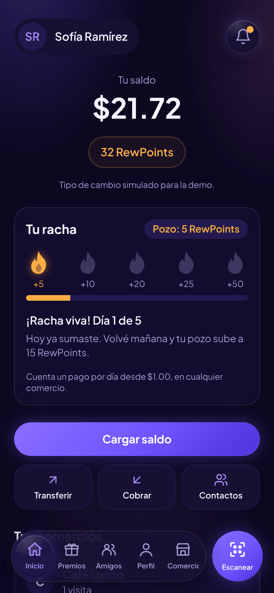
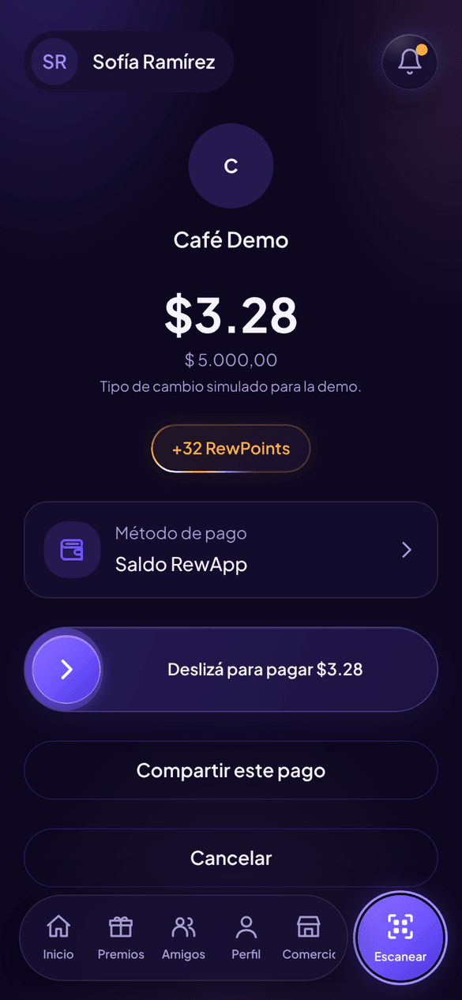
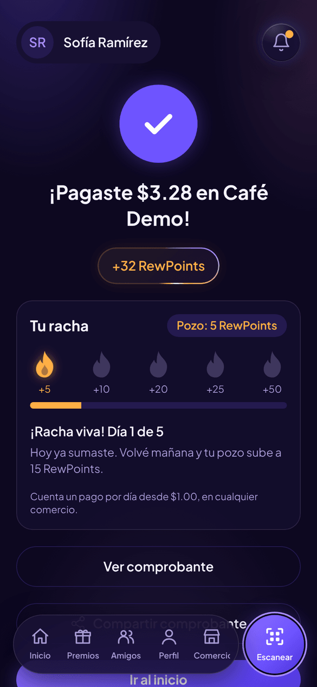
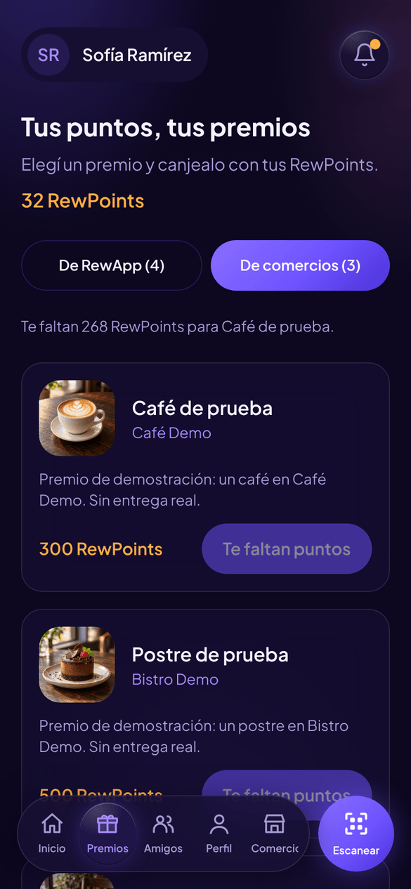

<p align="center">
  
</p>

<p align="center">
  <a href="README.md">English</a> · <b>Español</b>
</p>

<p align="center">
  <a href="https://rewapp-app.vercel.app"></a>
</p>

# RewApp

Red global de pagos prepagos con fidelización incluida. El cliente paga escaneando un QR y, en la misma transacción, recibe la recompensa que definió el comercio y suma RewPoints Customer. El comercio cobra al instante y suma RewPoints Commerce. Todo se muestra en la moneda local de cada uno, sin wallets, gas ni frases semilla.

Proyecto para la hackathon de Monad (tracks *Consumer Products & Payments* y *Best Mera-Powered UX on Monad*).

- **Producción:** https://rewapp-app.vercel.app
- Plan completo: [docs/PLAN.md](docs/PLAN.md)
- Arquitectura y estado del proyecto: [docs/ARCHITECTURE.md](docs/ARCHITECTURE.md)

## Probala

1. Abrí **https://rewapp-app.vercel.app** desde el celular (Chrome de escritorio con passkeys guardadas en el perfil local puede no soportar lo que necesita la cuenta).
2. Tocá **Crear una cuenta nueva**: nombre, email y tu huella o FaceID. No hay contraseña.
3. Tocá **Cargar saldo** y agregá un monto. Es una carga de prueba en Monad Testnet: no se cobra plata real. Antes del primer depósito la app te pide una passkey de respaldo.
4. Escaneá el QR de un comercio y deslizá para pagar. Vas a ver tus RewPoints, tu racha y la recompensa del comercio al instante.

¿No tenés un QR a mano? Generá un cobro de prueba de un comercio demo desde un clon del repo:

```bash
npm run demo:charge -- 5000        # ARS 5.000 en Café Demo; imprime el QR y el link
npm run demo:charge -- 12.50 eur   # EUR 12,50 en Bistro Demo
```

## Capturas

<p align="center">
  
  
  
  
  
</p>

<p align="center"><sub>Bienvenida · Inicio · Pagar un QR · Pago confirmado · Premios</sub></p>

## Stack

- PWA mobile-first en Next.js (App Router, TypeScript, Tailwind)
- Cuentas con passkeys vía [Mera](https://mera.category.xyz) (`@category-labs/mera`)
- Contratos en Solidity con Foundry, desplegados en Monad Testnet (chain ID 10143)

## Estructura

```
src/         App Next.js (UI y API routes)
contracts/   Contratos Foundry (USDr, RewAppPay)
docs/        Plan y documentación
```

## Desarrollo local

Requiere Node 22 y Docker Desktop iniciado (contenedores Linux).
[Foundry](https://getfoundry.sh) solo hace falta para trabajar sobre `contracts/`.

Desde la raíz del proyecto, en PowerShell:

```powershell
if (-not (Test-Path .env.local)) { Copy-Item .env.example .env.local }
npm.cmd ci
npm.cmd run db:setup
npm.cmd run dev                  # http://localhost:3000
```

En Bash, usá `cp .env.example .env.local` si el archivo no existe y `npm`
en lugar de `npm.cmd`. Si ya tenés configuración, conservá sus valores y
actualizá las dos conexiones de base de datos según `.env.example`.

La guía completa y canónica está en [AGENTS.md](AGENTS.md): Docker Compose,
migraciones, variables, verificaciones, passkeys locales y cobros de prueba.
Los scripts `db:migrate` y `db:status` cargan `.env.local` explícitamente;
no requieren duplicar las variables en `.env`.

## Tarjetas por usuario

En Inicio, abrí el menú de usuario → **Tarjetas** → **Agregar tarjeta**.
También podés hacerlo desde el selector que aparece al abrir un cobro QR.
Completá marca, últimos cuatro dígitos, titular y vencimiento, y confirmá con
tu passkey. Los metadatos se guardan en PostgreSQL en `SavedCard`, con foreign
key al perfil, y vuelven a aparecer en el selector al iniciar sesión.
Si actualizás una instalación local existente, ejecutá `npm.cmd run db:migrate`.

El formulario no pide número completo ni CVV. Todavía falta integrar un
proveedor para tokenizar y verificar tarjetas: el registro queda pendiente de
esa integración y no permite cobrar. Los pagos con tarjeta todavía están pendientes; para pagar en el MVP,
elegí el saldo RewApp.

En desarrollo, Inicio también tiene **Testing · Generar QR de cobro**:
crea un cobro de ARS 5.000 de Café Demo y muestra su QR, vencimiento y un
enlace para abrirlo desde la misma cuenta. El botón y su API solo funcionan
con `npm.cmd run dev`. Crear el QR no realiza un pago ni necesita la clave
del relayer.

## Contratos

- `USDr`: dólar de prueba (ERC-20 + permit EIP-2612, 6 decimales). Solo `ONRAMP_ROLE` puede mintear.
- `RewAppPay`: `payWithSig` cobra un `PaymentIntent` firmado (más el permit de USDr) y en la misma transacción reparte comercio / plataforma / recompensa del comercio y acredita RewPoints Customer y Commerce. También `setMerchantRule(WithSig)` (plantillas `CASHBACK` y `VISIT_BONUS`) y `redeemWithSig` (canje según el catálogo de cada público).
- ABIs y tipos EIP-712 para el frontend y el relayer: `src/lib/contracts` (regenerar con `cd contracts && forge build && cd .. && npm run contracts:export`).

Deploy en Monad Testnet (la clave del deployer necesita MON; queda como admin):

```bash
cd contracts
# opcional: MERCHANTS=0x...,0x...  RELAYER_ADDRESS=0x...  TREASURY_ADDRESS=0x...
forge script script/Deploy.s.sol --rpc-url monad_testnet --broadcast --private-key "$DEPLOYER_PRIVATE_KEY"
# Pago de punta a punta (comercio y pagador de prueba, el pagador con 0 MON)
forge script script/SmokePay.s.sol --rpc-url monad_testnet --broadcast --private-key "$DEPLOYER_PRIVATE_KEY"
```

Las direcciones quedan en `contracts/deployments/10143.json`.

Las passkeys quedan atadas a `NEXT_PUBLIC_RP_ID`. En producción es `rewapp-app.vercel.app` y no debe cambiarse.

### Monad Testnet (chain ID 10143)

Verificados en Sourcify (exact match):

| Contrato | Dirección |
| --- | --- |
| `USDr` | [`0x6e68D7b4Ea589F43B8DAbD36b2f4933fE4FA1d4a`](https://testnet.monadexplorer.com/address/0x6e68D7b4Ea589F43B8DAbD36b2f4933fE4FA1d4a) |
| `RewAppPay` | [`0x099DD721e4916e37b51E713FA72f7285101B2551`](https://testnet.monadexplorer.com/address/0x099DD721e4916e37b51E713FA72f7285101B2551) |

Relayer, admin y treasury: `0xf868F99177d3896C44064B8ce66980fed8dA49eD`.

```bash
forge verify-contract <dirección> src/USDr.sol:USDr --chain 10143 \
  --verifier sourcify --verifier-url https://sourcify-api-monad.blockvision.org
```
