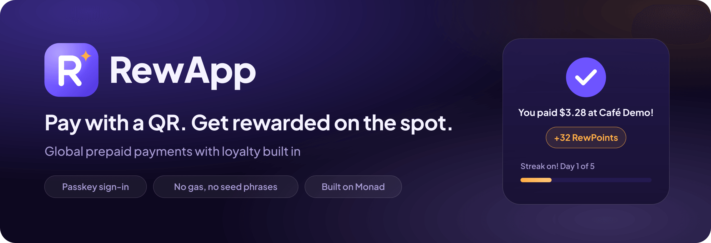
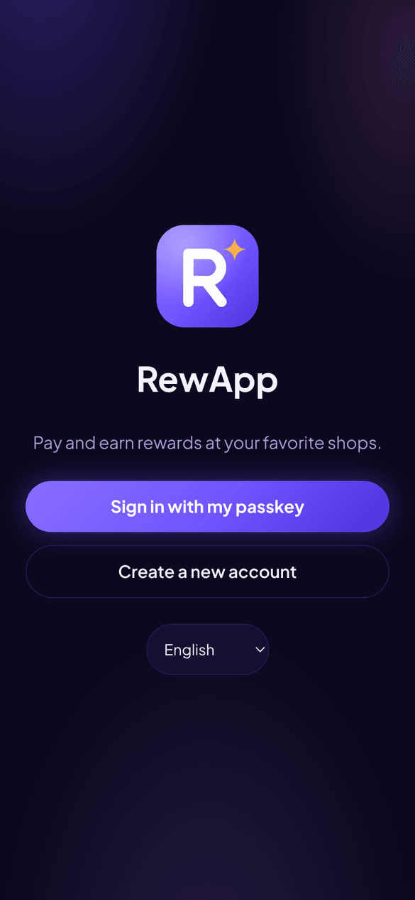
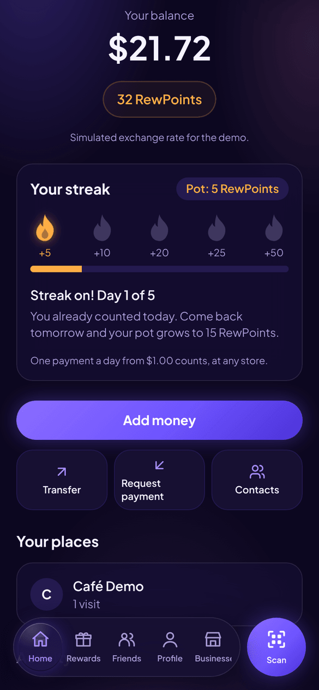
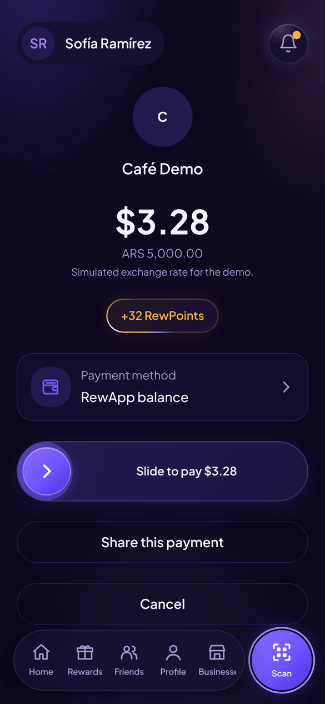
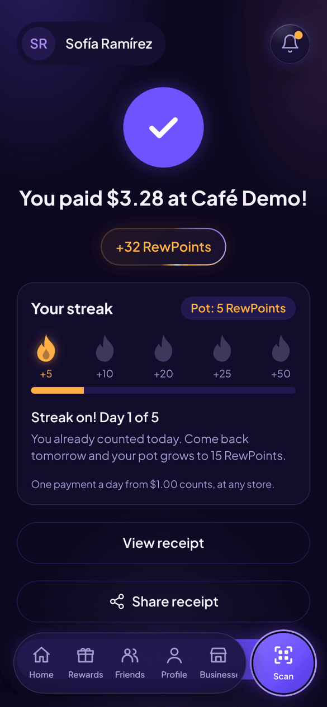
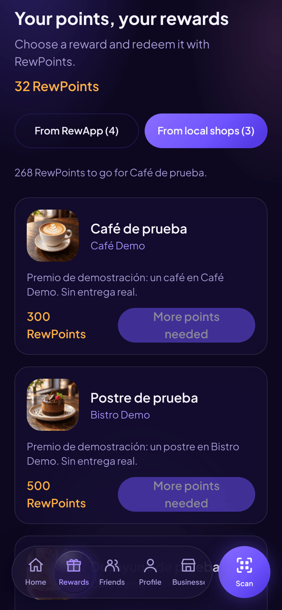

<p align="center">
  
</p>

<p align="center">
  <b>English</b> · <a href="README.es.md">Español</a>
</p>

<p align="center">
  <a href="https://rewapp-app.vercel.app"></a>
</p>

# RewApp

A global prepaid payments network with loyalty built in. Customers pay by scanning a QR code and, in the same transaction, get the reward the merchant set up and earn Customer RewPoints. Merchants get paid instantly and earn Commerce RewPoints. Everyone sees amounts in their own local currency, with no wallets, gas or seed phrases.

Built for the Monad hackathon (*Consumer Products & Payments* and *Best Mera-Powered UX on Monad* tracks).

- **Production:** https://rewapp-app.vercel.app
- Full plan: [docs/PLAN.md](docs/PLAN.md)
- Architecture and project status: [docs/ARCHITECTURE.md](docs/ARCHITECTURE.md)

> The docs in `docs/` and the contributor guide in [AGENTS.md](AGENTS.md) are written in Spanish.

## Try it

1. Open **https://rewapp-app.vercel.app** on your phone (desktop Chrome with passkeys stored in the local profile may not support what the account needs).
2. Tap **Create a new account**: name, email and your fingerprint or Face ID. No password.
3. Tap **Add money** and choose an amount. It's a test top-up on Monad Testnet: no real money is charged. Before the first deposit the app asks you to add a backup passkey.
4. Scan a merchant's QR code and slide to pay. You'll see your RewPoints, your streak and the merchant's reward right away.

No QR code at hand? Create a test charge from a demo merchant in a clone of this repo:

```bash
npm run demo:charge -- 5000        # ARS 5,000 at Café Demo; prints the QR code and link
npm run demo:charge -- 12.50 eur   # EUR 12.50 at Bistro Demo
```

## Screenshots

<p align="center">
  
  
  
  
  
</p>

<p align="center"><sub>Welcome · Home · Pay a QR · Payment confirmed · Rewards</sub></p>

## Stack

- Mobile-first PWA built with Next.js (App Router, TypeScript, Tailwind)
- Passkey accounts with [Mera](https://mera.category.xyz) (`@category-labs/mera`)
- Solidity contracts built with Foundry, deployed on Monad Testnet (chain ID 10143)

## Structure

```
src/         Next.js app (UI and API routes)
contracts/   Foundry contracts (USDr, RewAppPay)
docs/        Plan and documentation
```

## Local development

Requires Node 22 and Docker Desktop running (Linux containers).
[Foundry](https://getfoundry.sh) is only needed to work on `contracts/`.

From the project root, in PowerShell:

```powershell
if (-not (Test-Path .env.local)) { Copy-Item .env.example .env.local }
npm.cmd ci
npm.cmd run db:setup
npm.cmd run dev                  # http://localhost:3000
```

In Bash, use `cp .env.example .env.local` if the file doesn't exist, and `npm`
instead of `npm.cmd`. If you already have a configuration, keep its values and
update both database connections to match `.env.example`.

The full, canonical guide is [AGENTS.md](AGENTS.md): Docker Compose,
migrations, environment variables, checks, local passkeys and test charges.
The `db:migrate` and `db:status` scripts load `.env.local` explicitly, so
there's no need to duplicate the variables in `.env`.

## Cards per user

On Home, open the user menu → **Cards** → **Add card**.
You can also do it from the selector that shows up when you open a QR charge.
Fill in the brand, last four digits, cardholder and expiry date, and confirm with
your passkey. The metadata is stored in PostgreSQL in `SavedCard`, with a foreign
key to the profile, and shows up again in the selector when you sign in.
If you're updating an existing local install, run `npm.cmd run db:migrate`.

The form never asks for the full card number or CVV. A provider to tokenize and
verify cards still has to be integrated: saved cards wait for that integration
and can't be charged. Card payments are still pending; to pay in the MVP,
choose the RewApp balance.

In development, Home also has **Testing · Generate payment QR**:
it creates an ARS 5,000 charge from Café Demo and shows its QR code, expiry and a
link to open it from the same account. The button and its API only work
with `npm.cmd run dev`. Creating the QR doesn't make a payment or need the
relayer key.

## Contracts

- `USDr`: test dollar (ERC-20 + EIP-2612 permit, 6 decimals). Only `ONRAMP_ROLE` can mint.
- `RewAppPay`: `payWithSig` settles a signed `PaymentIntent` (plus the USDr permit) and, in the same transaction, splits merchant / platform / merchant reward and credits Customer and Commerce RewPoints. Also `setMerchantRule(WithSig)` (`CASHBACK` and `VISIT_BONUS` templates) and `redeemWithSig` (redemption against each audience's catalog).
- ABIs and EIP-712 types for the frontend and the relayer: `src/lib/contracts` (regenerate with `cd contracts && forge build && cd .. && npm run contracts:export`).

Deploying to Monad Testnet (the deployer key needs MON and becomes admin):

```bash
cd contracts
# optional: MERCHANTS=0x...,0x...  RELAYER_ADDRESS=0x...  TREASURY_ADDRESS=0x...
forge script script/Deploy.s.sol --rpc-url monad_testnet --broadcast --private-key "$DEPLOYER_PRIVATE_KEY"
# End-to-end payment (test merchant and payer, the payer with 0 MON)
forge script script/SmokePay.s.sol --rpc-url monad_testnet --broadcast --private-key "$DEPLOYER_PRIVATE_KEY"
```

The addresses are written to `contracts/deployments/10143.json`.

Passkeys are bound to `NEXT_PUBLIC_RP_ID`. In production it's `rewapp-app.vercel.app` and must not change.

### Monad Testnet (chain ID 10143)

Verified on Sourcify (exact match):

| Contract | Address |
| --- | --- |
| `USDr` | [`0x6e68D7b4Ea589F43B8DAbD36b2f4933fE4FA1d4a`](https://testnet.monadexplorer.com/address/0x6e68D7b4Ea589F43B8DAbD36b2f4933fE4FA1d4a) |
| `RewAppPay` | [`0x099DD721e4916e37b51E713FA72f7285101B2551`](https://testnet.monadexplorer.com/address/0x099DD721e4916e37b51E713FA72f7285101B2551) |

Relayer, admin and treasury: `0xf868F99177d3896C44064B8ce66980fed8dA49eD`.

```bash
forge verify-contract <address> src/USDr.sol:USDr --chain 10143 \
  --verifier sourcify --verifier-url https://sourcify-api-monad.blockvision.org
```
