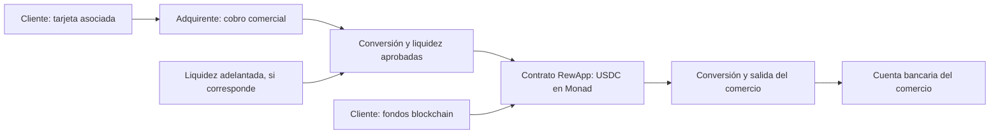

# RewApp: tarjetas asociadas y pagos a comercios mediante Monad

**Investigación y diseño revisado — 10 de octubre de 2026.**

El flujo principal es **cliente → comercio**. Ambos tienen cuenta en RewApp. El cliente asocia tarjetas o utiliza fondos blockchain; el comercio asocia una cuenta para recibir. No se exige recarga previa al comprador. Las transferencias entre particulares quedan en segundo plano.

Se distingue capacidad documentada de combinación pendiente de aprobación. No se confirmó un producto que ofrezca automáticamente el circuito completo mundial, con Monad y comercios de todos los tipos.

## 1. Qué papel tienen Visa y Mastercard

Sí: son las redes relevantes cuando se usan sus tarjetas. Para aceptarlas normalmente contratamos un **procesador/adquirente**, que conecta a RewApp y sus comercios con esas redes y los bancos emisores. No necesitamos emitir tarjetas propias.

La conversión a USDC y el depósito al comercio son funciones adicionales:

```text
Tarjeta asociada del comprador
    → procesador/adquirente y Visa/Mastercard
    → conversión o liquidez en USDC
    → liquidación en Monad
    → conversión a moneda del comercio
    → depósito bancario al comercio
```

Visa Direct ofrece AFT para obtener fondos de cuentas de tarjetas elegibles y OCT para enviar fondos a destinos elegibles. Mastercard Send, dentro de Move, ofrece movimientos hacia/desde tarjetas. Son opciones de movimiento de dinero; no compran por sí solas USDC en Monad. [Visa Direct](https://developer.visa.com/capabilities/visa_direct/docs), [Mastercard Send](https://developer.mastercard.com/product/mastercard-send/).

**Priorizaría adquirencia para plataformas**, con desembolsos a tarjetas como complemento posterior. La cuenta bancaria verificada del comercio sería el destino inicial.

## 2. El modelo recomendado: cobro comercial y liquidación por Monad

Hay dos rutas distintas:

| Ruta | Qué compra el cliente | Consecuencia |
| --- | --- | --- |
| Onramp en cada pago | Compra USDC y luego paga al comercio | Controles de comprador cripto, mínimos, comisiones y restricciones del emisor. |
| Cobro comercial con liquidación blockchain | Compra el bien o servicio; la infraestructura liquida mediante USDC | Mejor encaje para una experiencia cotidiana, condicionado al programa aprobado y la titularidad real de fondos. |

**Elegiría la segunda como objetivo principal.** Evita imponer por diseño una compra minorista de cripto a cada comprador. No implica automáticamente ausencia de controles de identidad: se aplican los que requieran el servicio real, el riesgo y los proveedores.



Esta estructura debe existir en contratos y operación. No basta cambiar el nombre de un botón ni presentar una compra cripto como una venta comercial ficticia. Hay que aprobar quién cobra por cuenta de quién, quién es dueño del fiat/USDC y quién responde por devoluciones.

El modelo ya existe en la industria: Checkout.com anunció en junio de 2026 liquidación de cobros en stablecoins para comercios empresariales elegibles en EE. UU., con Fireblocks. **No confirma Monad ni acceso para todos los comercios pequeños.** [Anuncio de Checkout.com](https://www.checkout.com/newsroom/checkout-com-scales-stablecoin-settlement-for-us-merchants-in-partnership-with-fireblocks).

Si queremos liquidar en Monad antes de recibir fondos definitivos del adquirente, necesitamos liquidez adelantada. Una autorización de tarjeta puede acabar en disputa: alguien debe financiar el desfase y asumir ese riesgo. Esto es financiación operativa del programa, no una precarga del cliente.

## 3. Cómo asociar y cobrar una tarjeta

1. El cliente acepta guardar su medio y completa un formulario seguro del proveedor.
2. El proveedor guarda/tokeniza la tarjeta. RewApp conserva identificadores, marca y últimos dígitos necesarios.
3. En compras posteriores se cobra usando el token y la autorización correspondiente.
4. El emisor puede exigir 3DS u otra acción; guardar la tarjeta no evita todas las autenticaciones.
5. El servidor confirma el estado y continúa la liquidación según el programa.

Adyen documenta `shopperReference`, `storedPaymentMethodId` y CardOnFile para este propósito. [Tokenización](https://docs.adyen.com/standard/integration/hosted-checkout/tokenization).

**El token tiene un ámbito.** No asumir que una tarjeta guardada en Stripe se puede cobrar desde Ramp, ni que se puede usar entre todos los comercios de una plataforma sin habilitarlo expresamente.

Para una compra cripto con tarjeta guardada, Transak documenta un ejemplo concreto:

```text
GET  /api/v2/payment-instrument/status
     → tarjetas guardadas y paymentIdentifierId

POST /api/v2/orders
     → quoteId + paymentIdentifierId + walletAddress + URLs de retorno
```

Ofrece componente integrado para JS/React/React Native y APIs de backend con habilitación y restricciones de IP. Puede exigir KYC y abrir una URL para autenticación. **No confirmé USDC + Monad en su catálogo actual:** su anuncio de Monad confirma MON y menciona stablecoins como expansión futura. [Headless Cards](https://docs.transak.com/features/headless-cards), [consultar tarjetas](https://docs.transak.com/api/whitelabel/payments/headless-cards/get-saved-cards), [crear orden guardada](https://docs.transak.com/api/whitelabel/payments/headless-cards/create-order-with-saved-card), [anuncio Monad](https://transak.com/blog/transak-integrates-monad-at-mainnet-launch-unlocking-global-access-to-mon).

No almacenaría PAN/CVV en RewApp. PCI prohíbe conservar CVV después de la autorización, incluso cifrado. [PCI SSC](https://www.pcisecuritystandards.org/faqs/1280/).

## 4. Proveedores que evaluaría

| Función | Candidato | Evidencia y condición |
| --- | --- | --- |
| Plataforma de comercios y cobro | **Adyen for Platforms**; comparar Checkout.com Integrated Platforms | Alta, verificación, cobros y payouts dentro de su alcance. Falta aprobar circuito con Monad, países y precio. |
| Conversión y liquidez | **zerohash**; Circle Mint para tesorería institucional elegible | USDC.Monad documentado. Validar producto contratado, entidades, titularidad y jurisdicciones. |
| Alternativa de compra exacta | **Ramp Network** | Compra/venta de USDC en Monad. Validar uso comercial, experiencia y salida para sociedades. |
| Depósito bancario | Socio empresarial de conversión/payouts por región | Debe admitir al comercio, moneda y origen de fondos. No basta que admita retiros minoristas. |
| Argentina: cobro local | Adquirente/PSP local; Mercado Pago como referencia funcional | Tarjetas guardadas y plataforma documentadas; el circuito con Monad sigue sin confirmar. |

Adyen for Platforms permite verificar vendedores, cobrar por ellos y distribuir fondos. Su lista incluye EE. UU., países europeos, Hong Kong y Singapur, entre otros; **Argentina no figura en el onboarding publicado de este producto**. No confundir presencia empresarial con cobertura de cada producto. [Plataformas y países](https://docs.adyen.com/platforms/).

Checkout.com distingue contractualmente su liquidación fiat de la conversión/entrega de activos digitales realizada por otro proveedor. Son piezas integrables con responsabilidades diferentes. [Condiciones](https://www.checkout.com/legal/service-terms).

zerohash documenta USDC.MONAD en producción, excluido en Nueva York. Su guía de remesas distingue PSP y proveedor cripto, pero incluye transferencias internas de ledger: **eso no demuestra ejecución onchain**. Para nuestro requisito deben existir transacciones verificables en Monad. [USDC.MONAD](https://docs.zerohash.com/changelog/mon-and-usdcmonad-now-available-across-trade-and-transact), [guía de integración](https://docs.zerohash.com/docs/remittance-integration-guide), [Circle: USDC nativo en Monad](https://www.circle.com/blog/now-available-usdc-cctp-wallets-and-contracts-on-monad).

Ramp documenta USDC en Monad y medios guardados dentro de su experiencia. No confirmé una API pública para administrar esos medios con el mismo control que un PSP convencional. Tampoco que su producto minorista sirva sin cambios a una sociedad comercial. [Monad en Ramp](https://rampnetwork.com/blog/monad-live-on-ramp-network), [medios guardados](https://support.rampnetwork.com/en/articles/322662-can-i-remove-my-saved-payment-method-details).

**Stripe Connect sirve como comparación de plataforma, pero sus stablecoin payouts consultados están en vista previa privada, limitados a plataformas estadounidenses y destinatarios individuales/empresarios individuales; no admiten empresas ni entidades sin fines de lucro.** No lo elegiría como solución única para comercios de todos los tamaños. Tampoco confirmé Monad. [Stripe: stablecoin payouts](https://docs.stripe.com/connect/stablecoin-payouts).

Mercado Pago documenta tarjetas guardadas y split payments en Argentina. El split estándar distribuye fiat al seller y la plataforma: **no confirma interponer Monad en la liquidación**. Las tarjetas guardadas también pueden requerir CVV nuevamente. [Tarjetas](https://www.mercadopago.com.ar/developers/es/docs/checkout-pro-orders/saved-cards?scope=prod), [split payments](https://www.mercadopago.com.ar/developers/es/docs/split-payments/split-1-1/overview).

## 5. Comercios de cualquier tamaño

El objetivo es que el comercio no negocie individualmente con Visa, opere un exchange ni mantenga inventario cripto. RewApp ofrece alta, QR/link, panel y cuenta de depósito; el programa incorpora y verifica a cada negocio como subcomercio.

| Comercio | Información y funciones que debe contemplar RewApp |
| --- | --- |
| Individual/pequeño | Identidad, actividad, domicilio, datos fiscales aplicables y cuenta destino admitida; cobro sencillo desde celular. |
| Sociedad | Registro y razón social, representación, beneficiarios finales exigidos, actividad y cuenta bancaria. |
| Empresa con sucursales | Además, establecimientos, usuarios/permisos, conciliación y destinos de liquidación autorizados; API/integración comercial cuando haga falta. |

Adyen contempla individuos, organizaciones y empresarios individuales, con requisitos según país y producto. No significa admisión de cualquier actividad, negocio informal o jurisdicción. [Onboarding](https://docs.adyen.com/platforms/onboard-users/onboarding-steps), [verificación](https://docs.adyen.com/marketplaces/verification-requirements/).

Un QR que abre RewApp permite diseñar cobros sin terminal dedicada. **No implica compatibilidad con cualquier app bancaria ni con todos los terminales de tarjetas.** Pagar contactless en terminales existentes es otro alcance; no se necesita para lanzar con comercios adheridos.

La cuenta bancaria sería la salida principal. Una tarjeta que permite comprar no necesariamente permite recibir depósitos. La recepción en tarjetas de crédito tampoco equivale universalmente a efectivo disponible.

## 6. Limitaciones regionales

Verificar país del comprador, emisor, comercio y entidad contratante; moneda, activo, red y salida. El logo Visa/Mastercard no garantiza esa combinación.

| Región | Ruta que evaluaría | Condición relevante |
| --- | --- | --- |
| **EE. UU.** | Adquirencia para comercios + USDC.Monad + salida USD | Aprobación de programa/estados. USDC.MONAD de zerohash excluye NY. Ramp documenta ACH/RTP y excluye EE. UU. de su payout a tarjetas. |
| **Europa/EEE** | Plataforma de comercios + socio cripto autorizado + SEPA | MiCA y permisos de pagos según actividad; SCA/3DS; no asumir una autorización para todo. |
| **Reino Unido** | Adquirente y conversión aprobados + Faster Payments | Régimen propio y cobertura contractual, separado del pasaporte MiCA. |
| **Argentina** | Adquirente local + socio PSAV/bancario con aprobación expresa | No confirmé tarjeta local → USDC.Monad → banco ARS completo. Revisar también normas cambiarias para compras cripto internacionales con tarjetas. |
| **Singapur** | Programa de pagos comerciales y socio cripto local | Para adquisición minorista de DPT hay restricciones sobre crédito emitido en Singapur. No extrapolarlas automáticamente a una venta fiat distinta. |
| **Hong Kong/Japón** | Programa local y activos admitidos | La disponibilidad internacional de USDC.Monad no demuestra admisión minorista/local ni soporte bancario. |
| **India y otros mercados asiáticos** | Socios locales con aceptación del flujo | Evaluación país por país; popularidad de una tarjeta o wallet no demuestra aceptación cripto. |
| **China continental y países con restricciones de pago cripto** | No habilitar por defecto el circuito | Evaluar la actividad efectiva: mostrar fiat en la interfaz no crea una excepción. |

Fuentes: [Ramp: salida](https://support.rampnetwork.com/en/articles/8992-what-payout-methods-are-available), [zerohash: jurisdicciones](https://docs.zerohash.com/docs/prohibited-and-restricted-non-us-jurisdictions-list), [EBA: PSD2/MiCA](https://eba.europa.eu/publications-and-media/press-releases/eba-advises-national-authorities-actions-take-end-transition-period-under-its-no-action-letter), [FCA](https://www.fca.org.uk/firms/new-regime-cryptoasset-regulation/registration-under-mlrs-ahead-new-fsma-regime), [BCRA](https://www.bcra.gob.ar/criptoactivos/), [MAS: servicios DPT](https://www.mas.gov.sg/regulation/guidelines/ps-g03-guidelines-on-consumer-protection-measures-by-dpt-service-providers), [SFC: stablecoins](https://apps.sfc.hk/edistributionWeb/api/circular/list-content/circular/doc?lang=EN&refNo=26EC26), [FSA: marco japonés](https://www.fsa.go.jp/inter/etc/20221207/01.pdf), [Razorpay: restricciones](https://razorpay.com/terms/), [PBoC](https://www.pbc.gov.cn/en/3688110/3688172/5552468/2025121116132332435/index.html).

**Argentina, comprobación pendiente específica:** A8307, de agosto de 2025, contiene en 4.1.4 requisitos de conformidad previa para acceso cambiario de pagos internacionales con tarjetas locales, incluyendo adquisición de criptoactivos. No pude recuperar el consolidado actual en esta consulta; debe confirmarse la versión vigente con el socio. No lo presento como prohibición universal a octubre de 2026. Tampoco es idéntico a cobrar una venta local real y operar una tesorería empresarial autorizada. [A8307](https://www.bcra.gob.ar/archivos/Pdfs/comytexord/A8307.pdf), [normativa vigente](https://www.bcra.gob.ar/normativa-de-exterior-y-cambios/).

Ramp exige mismo titular tanto para financiar una compra como para recibir el payout de una venta. No se debe comprar desde la cuenta del cliente y pedir que ese retiro minorista vaya a la cuenta del comercio. El comercio necesita una relación de salida propia y autorizada. [Entrada](https://support.rampnetwork.com/en/articles/12621-can-i-use-someone-else-s-card-or-bank-account-to-buy-crypto), [salida](https://support.rampnetwork.com/en/articles/209629-can-i-use-someone-else-s-card-or-bank-account-to-receive-payouts).

## 7. Conexión directa a las redes

Visa Direct requiere adquirente autorizado u originador patrocinado, aprobación de programa, Acquiring BIN y pruebas/certificación. El sandbox no concede acceso comercial; también hay que operar liquidación, reportes y disputas. [Requisitos Visa Direct](https://developer.visa.com/capabilities/visa_direct/docs).

Para el lanzamiento, un adquirente para plataformas resuelve más funciones del objetivo comercial. Ir directo sigue dejando pendientes conversión, liquidez, alta de comercios y salida. Puede negociarse después si la escala justifica el costo fijo.

Visa tiene un piloto de liquidación en stablecoins para emisores/adquirentes. Su anuncio de abril de 2026 enumera nueve cadenas y **no incluye Monad**. No es una API universal tarjeta → USDC.Monad. [Visa: redes del piloto](https://corporate.visa.com/en/sites/visa-perspectives/newsroom/visa-expands-stablecoin-settlement-adds-five-blockchains.html).

## 8. Implementación en RewApp

1. Alta y verificación del comercio y de su cuenta bancaria; validar recepción antes de aceptar cobros reales.
2. Tarjetas tokenizadas del cliente, consentimiento y origen blockchain opcional.
3. QR/link/checkout que identifica compra, comercio e importe; cotización del total y neto antes de confirmar.
4. Cobro con el PSP y eventual autenticación; confirmación de servidor.
5. Conversión o reserva de USDC conforme al programa; liquidación real en Monad.
6. Conversión de salida y depósito al comercio; estado bancario separado del estado onchain.
7. Ledger, conciliación, idempotencia y recuperación de fallos; política de refunds y contracargos.

Si el cliente usa USDC en Monad, no hay entrada con tarjeta. Para otro activo, cotizar el swap; para otra cadena, evaluar una ruta admitida como CCTP para USDC. El gas puede seguir patrocinado.

El [contrato actual](../contracts/src/RewAppPay.sol) extrae saldo de `payer` y le asigna cashback/puntos. Financiar una compra fiat desde tesorería exige separar financiador y cliente: reemplazar `payer` atribuiría mal la fidelidad. También faltan configuración/despliegue USDC, adaptación de firmas, medios asociados y estados financieros. Este documento no implementa esos cambios.

Medir costo completo: adquirencia, FX/conversión, liquidez adelantada, gas, salida, fraude y operación. No asumir que pasar por Monad elimina comisiones de tarjetas o hace viable una compraventa minorista por cada café. Puede ser más económico reequilibrar tesorería y agrupar depósitos consentidos, pero debe probarse con tarifas empresariales.

**Recomendación:** plataforma de cobros con alta de subcomercios y tarjetas asociadas; Monad en la liquidación; salida bancaria empresarial. Contratar la combinación por corredor y ofrecer una misma experiencia de uso. Antes de producción, confirmar admisión de pequeños negocios y sociedades, USDC nativo en Monad, titularidad, contracargos, financiación y costo neto de punta a punta.
